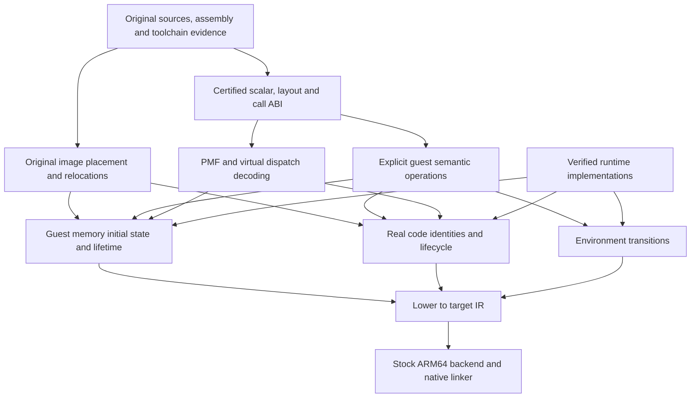

# Deriving a guest ABI compiler from the original program

This is a design and evidence report, not a compiler implementation. The existing
HeartGold compiler, linker, image selection, source adaptations and upstream tree
are unchanged. The proposed machine has four contracts: guest language/value
elaboration, guest byte memory, guest control transfer, and environment effects.
Image placement and relocations construct their initial state. Changing data
emission alone, or adding a pass after ordinary LP64 compilation, is insufficient.

## 1. Evidence, scope and the meaning of preservation

Reproduce the investigation against the existing configured build:

```sh
python3 -B tests/investigate_guest_abi.py --build build
python3 -B tests/test_native_abi.py
```

The first command writes only into the selected binary directory. It emits:

- `guest-abi-design/census.json`: every `main.lsf` member, original owners, source
  classification, available source hashes and lexical investigation candidates;
  matching declarations in the original `include/` and `lib/include/` trees.
- `evidence.json`: compiler version, commands, diagnostics, source/object/library
  hashes and explicit distinction between original-object evidence and probes.
- Extracted declarations/operation slices, LLVM IR, ARMv5 and ARM64 objects and
  disassembly at O0/O2; data contents and relocations at O2. Six actual native
  DWC/Plaza compilation objects are disassembled independently of the probes.
- A small executable linked against the current built SDK libraries, with its
  observed output. It does not replace any SDK implementation.

The manifest has 132 images, 1,757 member placements and 1,751 distinct members:
1,519 C, 62 C++, 150 assembly and 20 with no located source representation under
that classifier. These are whole-manifest counts, not the narrower 805-unit
original C/C++ compilation audit. Lexical matches occur in 492 members for
integer-cast candidates, 104 for raw offsets, 67 for bitfields, 196 for assembly,
2 for member-pointer expressions, 11 for varargs, 3 for context operations and
132 for device operations. These categories overlap; matches include comments,
ordinary integer casts and inactive branches. They are an auditable search index,
not a claim that 492 files have pointer bugs or that every operation was proved.
The adaptation table has 528 entries; an entry is not a semantic incompatibility.

The starting report is `build/abi-barrier/report/graph.json`: 92 actual dylibs
pass binding validation, consisting of 91 exact-member images and one separately
counted protection replacement. OVY_0 and OVY_45 fail representation selection,
not an actual linker invocation. OVY_49 has 149 actual undefined imports owned
by OVY_45. No new image closure is claimed here. Missing source, missing genuine
providers, unconverted instructions and ABI errors remain different obligations.

### What is the reference program?

`compile(P, guest, target)` is underspecified if `P` means only ISO C/C++ source.
The socket-error store accesses the word beyond a pointer object; private
cross-unit declarations disagree as language types while intentionally naming
shared byte coordinates. A portable-language optimizer need not preserve those
operations. Preservation requires either:

1. A specified original language/toolchain profile that gives these operations
   meaning, with sufficient original machine evidence; or
2. The original machine program plus its ISA and environment semantics.

Undefined language behavior cannot acquire the desired meaning merely through
sanitizers or a later IR repair. [Clang's sanitizer documentation](https://clang.llvm.org/docs/UndefinedBehaviorSanitizer.html)
describes checks, not a replacement execution semantics.

The original Makefile selects CodeWarrior, normally 2.0/sp2p2, with per-file
1.2/sp2p3 and 2.0/sp2p3 overrides; ARM946E/ARM5TE, signed char, int enums and
per-unit options appear in `Makefile` and `common.mk`. Some units enable C++
exceptions. The ARMv5 Clang probes below are comparisons, **not certification of
CodeWarrior**. No authoritative original executable was executed for this report;
no ARM execution oracle was available in the inspected environment. An unrelated
open Ghidra program was excluded. Original ARM assembly is evidence for the
operations it actually specifies; synthetic ARM output cannot establish an
unknown original PMF, bitfield or variadic convention.

## 2. Root causes and exact divergence points

Paths below are relative to `upstream/pokeheartgold`. Instruction examples come
from reproducible generated probes unless explicitly identified as actual
objects. Each probe is labelled in `evidence.json`; none supplies missing game
functions. Existing executable counterexamples are described in
[SHARED_ABI_BARRIER.md](SHARED_ABI_BARRIER.md).

| Class and original operation | Intended guest observation | Measured ARM64 behavior / first divergence | Required boundary |
| --- | --- | --- | --- |
| Pointer arithmetic and casts: `src/voice_chat.c` rounds `((u32)*allocation+31)&~31` | Round a 32-bit guest address; retain its address identity | Probe loads `w8`, adds in `w8`, masks, stores `x8`: high native address bits are irrecoverable. Integer tick truncations elsewhere are intentional and must remain integer operations | Guest pointer/value elaboration, before native pointer formation |
| Record layout: `dwc/match_internal.h`, `match_browse.c` | MatchKeyEntry stride 12, value +8; literal clear 1,848 bytes covers 154 records; raw and typed indexing agree | Typed probe uses multiplier 24 and `ldr x0,[x8,#16]`; raw probe still multiplies by 12. ARM comparison computes 12 and loads +8 | Frontend layout and all memory consumers, not just global size |
| Intentional adjacent storage: `dwc_login.c`, `asm/dwc_lib_bss.s` | `gDwcControl` is pointer word at +0 and error word at +4, total assembly storage 8 | `str w0,[x8,#4]` has the same numeric offset but modifies the upper half of the LP64 pointer | Original toolchain/machine semantics and guest-width memory |
| Interior labels/aliasing: `gs_platform.c`, `asm/dwc_gamespy_bss.s` | `ov00_0221B1B4-8` yields an alias whose first four-byte pointer word is zero even when adjacent lastError is 7 | Native eight-byte pointer read includes both words, becomes non-null. `alias_base` optimizes to just returning the base: widening allocation cannot fix the interpretation | One shared byte store, address arithmetic, width-correct loads |
| Callbacks stored in integers: `query_report_init.c` vs `server_report.c` | QueryReport and QRRecord describe the same 272 bytes, callback words +136 onward, userdata +268, heartbeat +172 | Writer stays 272 bytes and emits 32-bit stores. Reader grows to 320 bytes, emits `ldr x3,[x0,#136]`, `ldr x2,[x0,#312]`, `br x3`. Native callback information can be lost at the u32 argument conversion even before storage | Guest code values, guest layout, indirect-call lowering, whole call boundary |
| Pointer/scalar records: `cps/cps_ssl_internal.h` CpsRootCa, original CA assembly records | Pointer words and scalar lengths retain distinct four-byte interpretations and relocations | Size 20 vs 40. By-value shape probe is ARM `[5 x i32]` plus aligned-4 sret versus native indirect input plus aligned-8 sret | Layout plus aggregate call classification; by-value probe is a shape test, not a claim this exact call occurs |
| Global/stack/heap addresses: globals above, voice-chat heap alignment, address-taken local probe | Any exposed address is a guest address, with original lifetime/alignment and observable arithmetic | Global accesses acquire native GOT addresses; stack probe passes `x29-4`. Both become wrong if subsequently stored in a guest word. Native heap allocation likewise does not establish guest identity | Memory placement and guest frames; addressable locals cannot remain unconditionally native allocas |
| Private cross-unit views: `lobby_chat_remove_channel.cpp`, canonical lobby headers and implementations | Root channels at +128; node count/root/first at 28/32/36 in the private guest view | Private native view is 28/32/40; canonical native view is 48/56/64, map base 184. Probe and actual object's private access retain +128. Independent native layouts no longer describe one object | Common guest byte coordinates across translation units, no requirement to merge incompatible native C++ types |
| C++ PMFs: `ppw_lobby_players_all_have_profiles.cpp`, `lobby_chat_remove_channel.cpp` | Two observed constants are code word plus zero adjustment; prefixes and guest byte extents retained | Guest comparison PMF 8 bytes, native 16; Holder 12 vs 24. ARM64 uses `ldp x1,x8,[x8,#8]`, `add ... asr #1`, tests adjustment bit 0, optionally reads a vtable then branches. A relocated function word alone is insufficient | Original PMF ABI decode, guest receiver adjustment and call lowering |
| Vtables/manual dispatch: `LobbyRequestVtable`, private Value virtual declaration | Guest table slot widths, receiver layout and original call shapes agree | Four native function slots occupy 32 rather than 16 bytes. A genuine C++ receiver test passes only for its declared native class; that does not certify original C functions used through type-erased member calls | Guest class ABI or explicit manual-table semantics; cannot infer all tables are compiler vtables |
| Tagged pointers: `src/lobby/ppw_lobby.cpp` TreeIterator parent word and `~1UL` | Preserve integer tag masks, 32-bit unsigned long and pointer recovery | Native long is 8, guest comparison long is 4; frontend constants, promotions and masks change before backend selection | Scalar widths and guest pointer bit semantics, not merely sizeof(void*) |
| Bitfields/alignment: `include/map_header.h`, `dwc/ap_connect_internal.h` | Original storage units, allocation order, signedness, padding and access widths | MapHeader positive-control initializer agrees in the two Clang data dumps. That does not prove CodeWarrior's other bitfields or packed structs agree | Frontend record ABI, golden original bytes/accesses; reject uncertified layouts |
| Varargs: `lib/include/stdarg.h` MSL char-pointer list, argument-home formula | Guest argument homes and traversal match original caller convention | Native builtin probe retains `va_arg`/`llvm.va_start`; ARM comparison explicitly advances a four-byte list. MSL formula native IR masks a host pointer to 32 bits. Host va_list is not an MSL list | Guest call/argument-home elaboration before target-specific varargs lowering |
| ARM/Thumb code/relocations: original `.word` labels, interworking, inline assembly | Guest symbol values, low-bit instruction state, literal pools and relocation formulas remain observable | ARM probe has R_ARM_ABS32; Thumb probe's symbol-table value is 1 for callback at text offset 0. Native data uses an eight-byte ARM64 unsigned relocation. Native branch instruction is not ARM `bx` | Image construction and ISA-aware code representation, distinct from Mach-O relocation |
| Nonlocal control: original `lib/NitroSDK/src/os/os_context.c` | Save initially returns 0, saves return value 1 in context; load restores registers/status/PC and resumes saved continuation | Actual linked SDK probe prints initial_save=1 and load_returned=1. Its SDK_PORT code returns TRUE and returns from load | Resumable guest control/register state, not ordinary host call ABI or setjmp substitution |
| Platform effects: original MMIO, CP15/cache and SWI operations | Width, order, registers and device-visible effects follow guest environment | Native RAM loads or ignored cache/control operations do not implement devices; current host threading bypasses original scheduling | Explicit effect semantics, ISA decoding where needed, host service implementation |
| SDK implementation behavior: MI word-clear | Repeated store of the entire original 32-bit pattern | Actual SDK-library probe: clearing with 0x11223344 produces 44444444,44444444 due to memset | Independent runtime implementation correctness; ABI conversion cannot repair a different algorithm |

### Additional evidence and limits

The actual `query_report_init` object stores at +0x10c in four-byte width. The
actual Plaza objects contain the private-layout/member-call operations; the
extracted O2 probes make the coordinate and dispatch differences easier to audit.
`dwc.*.O2.ll` contains the complete measured layout vectors:

```
                   ptr key value Query QRRecord heartbeat(Query/QR) CA
ARMv5 comparison:     4  12     8   272      272           172/172   20
ARM64:               8  24    16   272      320           172/208   40
```

Apple ARM64 here uses the ARM-style adjustment-bit virtual flag, not the generic
Itanium pointer-bit rule. The generated instructions establish that fact for
this target. Clang's [ItaniumCXXABI implementation](https://llvm.googlesource.com/llvm-project/clang/+/refs/heads/main/lib/CodeGen/ItaniumCXXABI.cpp)
contains separate ARM and non-ARM member-pointer rules; neither proves the full
CodeWarrior ABI. Direct zero-adjustment constants do not test multiple
inheritance, virtual PMFs, null encoding or covariant thunks.

The GameSpy private struct's guest size is 52 and native size 80 under these
layout assumptions; those numbers do not describe the full original BSS extent
or license reducing its other labels/padding. The existing data converter's
source-hashed coordinate checker correctly rejects conflicts. Its bounded native
PMF emitter passes native declared-class calls, but cannot fix original object
views or certify the original C callee as that native class member.

`cmake/native_sources.py` owns existing build-only adaptations. Declaration
normalization, ARM helper translations and width-dependent native rewrites must
be classified separately when admitting a guest compilation unit. The new guest
path must consume original semantics; applying an LP64 adaptation and then guest
lowering can double-transform an operation. Original source hashes, adaptation
identity and per-unit toolchain options must be recorded at the boundary. A
successful compile, binding validation or sanitizer test is not layout proof.

Concrete adaptation boundaries visible in `cmake/native_sources.py` are:

| Existing adaptation | Guest compilation treatment |
| --- | --- |
| `callbacks()` changes sound payload u32 declarations to uintptr_t | Guest payload remains a guest word; native sound calls require a boundary, rather than inheriting the widened declaration |
| `party_actions()` converts integer callback table entries to indices | Guest path retains original code-address words and indirect-call semantics; do not apply the index rewrite again |
| `adapt_original()` ExpHeap pointer arithmetic and metadata alignment changes | Use original guest metadata/alignment for guest execution; native heap metadata is a different domain |
| `comm_state.c` and wireless-manager uintptr_t rounding | Guest address arithmetic needs the original 32-bit model; the native rounding adaptation is not the guest frontend |
| Private declarations, native libc and callback prototype normalization | Recheck against the admitted guest language and boundary signatures; declaration repair alone is not layout certification |

Source landmarks for the central counterexamples are `dwc_login.c:38`,
`match_browse.c:104` and `:737`, `match_internal.h:71`,
`query_report_init.c:78`, `server_report.c:106` and `:531`,
`gs_platform.c:771`, `voice_chat.c:255`,
`ppw_lobby_players_all_have_profiles.cpp:47`, and
`lobby_chat_remove_channel.cpp:94` and `:119`. The census and evidence hashes
allow drift to be detected instead of treating these line numbers as contracts.

The SDK probe links the current built archives, not a hypothetical clean clone
of the published libntr pin. The local review source explains both observations.
Original ARM MI assembly repeatedly stores the full register; OS assembly saves
CPSR/registers and restores PC through `subs pc,lr,#4`. Neither SDK discrepancy
was changed here. The approved backward decompression translation is a separate
positive case: its overlap read/write order and cache synchronization are part
of its contract, not permission to replace all low-level routines with memcpy.

## 3. Minimal semantic contracts

“Independent” below means one contract cannot be inferred from the others, not
that a Turing-complete machine could not implement all of them with fewer opcodes.
Use fixed-width values, a byte store and explicit state transitions; no operation
mentions a game, image number or source pathname.

### V: Guest language/value elaboration (compile time)

Input: original declarations, expressions, dialect/toolchain profile and proven
implementation-defined behavior. Output: guest-width scalar operations, guest
layout constants, byte-address expressions, class/call operations and explicit
effects. The layout query returns size, alignment, member bit ranges, allocation
units and class ABI facts. Integer casts preserve the specified bit conversion;
address/integer round trips preserve guest bits. Signed overflow, shifts, FP
rounding and unaligned behavior follow the selected semantics, not an invented
universal wrapping rule. Unsupported source UB is rejected or represented from
original machine instructions, never silently assigned a convenient meaning.

Different struct ABIs can use the same byte store and code executor but compute
different field addresses: V is not determined by memory/control services. The
same profile must govern every separately compiled unit. Opaque byte views may
share storage without pretending their incompatible declarations are one ISO
C++ object type.

### M: Guest-addressed byte memory (execution)

A guest address is a 32-bit bitvector for this guest. Its representation is
independent of the target pointer width. Define:

```
read(state, address_bits, width, access_kind) -> (bytes, state, effects)
write(state, address_bits, bytes, access_kind) -> (state, effects)
```

Address arithmetic and validity checks are separate. Arbitrary tagged/protocol
values may be stored and compared without dereference. At access, the memory
model supplies mapping, lifetime, permissions, alignment and original access
semantics; byte order controls scalar encoding. Width-crossing/wrapping accesses
must follow the machine, not merely wrap a host array index. Some effects go to
E, not RAM. Reads through different types observe the same original bytes.

Globals, address-taken stack locals, argument homes, original heap allocations,
interior labels and array elements all use M. They are placements/lifetimes,
not five new pointer kinds. The original heap algorithm can execute on this
memory; a host malloc result cannot simply be truncated. Keep values in native
SSA or registers only when no guest observation distinguishes that optimization.
A guest local whose address escapes needs guest-addressable storage; frames must
survive exactly the original lifetime, including suspended continuations.

A reserved contiguous host range with checked offset translation is one possible
implementation for suitable RAM, not the semantic definition or a requirement
to reserve all 4 GiB. Do not require guest addresses to equal host addresses.
Different mappings give different results with identical V and code: M is an
independent contract.

### C: Guest control transfer and call state (execution)

Data/code values share the guest-observable bit namespace. A code reference is
not a host function pointer. Call/jump consumes guest code-address bits and
instruction state, guest argument/receiver/return representation and control
state. It must enter a genuine compiled implementation, or diagnose unsupported
execution; an absent provider is never implemented by a dispatcher entry.

For a certified source subset, internal native entry points can use a uniform
private ABI carrying a guest frame/state pointer and scalar values. Call packets
preserve original argument homes, aggregate bytes and returns where observable.
For mixed machine objects, packets must expose the actual guest register/stack
convention. Code-address resolution associates original addresses with real
compiled blocks; direct calls may bypass lookup only with equivalent identity
and image-lifetime behavior. Thumb bit handling belongs to this guest's code
model; do not discard it from stored values or comparisons.

Full-program C must support resumable control state, not just C calls/returns.
OS_LoadContext can abandon the current call chain. Machine inputs require the
relevant registers, flags, PC and modes; source inputs need equivalent explicit
continuations wherever execution exposes them. A function-only prototype must
reject these cases. Native setjmp alone is not a derivation of guest CPSR,
register restoration, scheduler behavior or original stack semantics.

Identical data memory can bind a code address to different implementations or
instruction states and produce different callbacks. M does not determine C.

### E: Environment transitions (execution)

Device operations, host SDK calls, interrupts, scheduling and I/O exchange
explicit values/state/events with the outside world. A boundary contract states
argument roles, results, effects, reentry, lifetime, threading and error behavior.
It distinguishes a guest span, a guest code callback, raw protocol bits and an
opaque host resource. `void *` alone cannot specify the role: Pokewalker code
uses pointer-typed protocol constants and narrows them to 16 bits.

Host pointers never leak into guest words. Shared data adapters must preserve
identity, overlap, interior aliases and mutations, including asynchronous
ownership. Blind deep copies are insufficient. Callback thunks must reenter C
with the original guest code value and marshalled arguments. Prefer compiling
original SDK code under the guest model when possible; native hardware services
remain explicit, verified boundaries. This is a proposed compiler contract,
not permission to install a guest import framework in the existing game build.

The same pure program/memory can have different device behavior: E cannot be
inferred from V/M/C. ABI-correct wrapping of an unfaithful host service, as in
the MI and context probes, remains incorrect.

### Derived operations and image construction

- Pointer arithmetic = V's element size + bitvector arithmetic; dereference = M.
  Bitfields = V's bit ranges + M accesses + specified integer extraction/update.
- PMF invocation = guest ABI decode + this adjustment + optional guest vtable
  loads + C transfer. It needs no Plaza opcode. Native C++ PMF layout is irrelevant
  to the stored guest representation.
- Relocations = guest image/symbol placement + original relocation formula,
  encoded into M or code semantics. Image identity and address are separate:
  overlays can reuse guest addresses. Generation belongs to internal code-cache
  validity, never an extra visible pointer tag.
- Loading/unloading = defined memory initialization, relocation, permissions,
  constructors/destructors and code-binding transitions. Original `After`
  placement constraints are not a complete runtime dependency graph.
- Global/stack/heap access and callback adapters are consequences of these
  contracts, not additional representation frameworks.

These derivations require original metadata/instructions. RAM does not reveal
whether an arbitrary word is a function, integer or relocation, so infer neither
from its numerical range. Preserve scalar words and explicit symbol identities.

## 4. Compiler boundaries and reuse

The recommended pipeline has two admitted input routes, sharing a small semantic
normal form. This is a boundary design, not a proposal for two new compilers now.

```
certified original source + guest ABI frontend ------+
                                                    +--> explicit V/M/C/E operations
original ARM/Thumb objects + ISA semantics ---------+     + guest image metadata
                                                          |
                        normalize guest calls, frames, aliases, effects
                                                          |
                    optimize under guest contracts, lower M/C/E to native IR
                                                          |
                           existing LLVM ARM64 backend and Mach-O linker
```

No custom LLVM backend is initially justified. Once addresses are guest integers,
accesses are explicit, aggregate/call conventions normalized and effects retained,
ordinary LLVM can select ARM64 instructions and the host ABI. A tiny explicit
IR can be LLVM integers plus well-specified helper calls; a new dialect/framework
is not a prerequisite. The helpers are compiler/runtime operations, not invented
game exports. Native linkers still resolve genuine generated bodies.

| Component | Must decide here | What it cannot repair later |
| --- | --- | --- |
| Preprocessing / Clang frontend, AST and ABI codegen | Original scalar formats, macros, sizeof/offsetof, record/bitfield/class ABI, PMF interpretation, aggregate ABI, argument homes, permitted aliases | Already folded LP64 constants, changed overload/template choices, invalid type-based assumptions |
| Early semantic IR normalization | Explicit guest integer addresses, byte accesses, addressable frames, original-call transport, guest code references; remove target-specific guest commitments by translating them | Undefined behavior already exploited, unavailable original ABI facts, missing assembly semantics |
| LLVM middle end | Optimize those explicit contracts; prove safe direct/native fast paths | Reconstruct lost source layouts or infer u32 callback identity after truncation |
| LLVM backend | Native registers, physical host stack, host calling convention, instruction selection | Guest varargs, guest sret/byval, CPSR or guest context behavior unless already represented |
| Image/relocation processing | Original membership, guest placement, symbol/addend/interworking rules, guest bytes, real code entry bindings | Consumer stride/load width or function type mismatch |
| Runtime | M/C/E contracts, code mapping lifecycle, host boundary implementations | A source compile that assumed different objects or a service with different effects |

Stock guest-target Clang can supply useful layouts and early IR for a **certified
subset**. It is not enough to change the triple/data layout of that IR and emit
ARM64. The shape probe already contains different sret alignments and aggregate
parameters; varargs still depend on target lowering. Inline ARM assembly and
intrinsics are target operations. Even O0 IR can contain `inbounds`, overflow
flags, attributes, alias metadata and language lifetime assumptions requiring
review before optimization.

LLVM [GEP semantics](https://llvm.org/docs/GetElementPtr.html) make clear that
GEP computes addresses using layout and is not itself a memory load. LLVM's
[IR specification](https://releases.llvm.org/17.0.1/docs/LangRef.html) defines
pointer, overflow and attribute constraints that the lowered representation
must satisfy. A target data layout is not a guest address-translation service.
A pointer address space alone does not specify guest code calls, arbitrary
integer aliases or device accesses.

For original ARM code, [AAPCS32](https://github.com/ARM-software/abi-aa/blob/main/aapcs32/aapcs32.rst)
and [AAELF32](https://github.com/ARM-software/abi-aa/blob/main/aaelf32/aaelf32.rst)
provide reference call/relocation definitions. The actual original toolchain's
objects remain the authority for its choices. Calls across compiler versions or
source/machine routes require a certified common guest call representation.
Unknown ABI details are admission failures, not new config defaults.

## 5. Minimal typed specification

The specification describes semantic decisions, not a menu of source rewrite
rules. Here is a typed interface sketch; the functions are contracts, not an
implemented configuration framework:

```text
Compiler(runtime: RuntimeContract).compile(
  P: Program, guest: GuestSpec, target: TargetSpec
) -> Result[Artifact, Unsupported]

Program = {
  units: Sequence[SourceUnit | MachineUnit],
  images: OriginalImagePlan
}
SourceUnit = { source, headers, macros, dialect, original_toolchain_options }
MachineUnit = { original_sections, symbols, relocations, instruction_mode }

GuestSpec = {
  language: LanguageABI,       // scalar formats + layout/call/class rules
  memory: AddressMemoryModel,  // address width, endian, mapping/access semantics
  code: CodeModel,             // instruction-state bits, calls, resumable state
  image: ImageModel,           // symbol/relocation and load-lifetime semantics
  semantics_id: CertifiedProfileID
}
LanguageABI = {
  scalar(Type): ScalarSemantics,
  layout(Type): Layout,        // size/alignment/field bit ranges
  elaborate(Operation): GuestOperation | Unsupported,
  call(Signature): GuestCallContract,
  class_abi: CertifiedClassABI // PMF/vtable/thunks/RTTI/EH, or unsupported
}
AddressMemoryModel = {
  address_bits, byte_order,
  access(State, AddressBits, Access): Transition
}
CodeModel = {
  decode_address(AddressBits): CodeLocation | Invalid,
  transfer(State, CodeLocation, GuestCallOrJump): Transition
}
ImageModel = {
  place(OriginalImagePlan): GuestPlacement,
  relocate(Relocation, GuestPlacement): EncodedBytes | Unsupported,
  lifecycle(State, ImageEvent): Transition
}
TargetSpec = { ISA, host_ABI, object_format, supported_codegen_features }
RuntimeContract = { memory_implementation, control_implementation,
                    environment_boundaries, supported_effects }
Artifact = { native_objects, guest_image_bytes, guest_relocations,
             real_code_bindings, compatibility_manifest }
Unsupported = { unit, operation, required_contract, evidence }
```

For this guest, address_bits=32, byte_order=little; int/long/pointers have original
32-bit representations. Other widths, floating-point edge behavior, wchar,
bitfield/class ABI and exceptional control must be certified, not inferred from
those three facts. The target is ordinary ARM64 Darwin, not automatically
arm64e with its additional authenticated-pointer ABI.

`semantics_id` covers actual rules and evidence, not merely a compiler version
string. Per-unit options are inputs to language elaboration. The output manifest
records input hashes, profile, guest layout/call identifiers, symbol ownership
and supported effects. Separately compiled modules must agree on these contracts;
a mismatch is rejected before binding. Intentional private byte views are checked
against guest coordinates rather than forced into one native type declaration.

The image plan retains exact original membership/identities. Its metadata is not
a newly invented per-overlay algorithm. Native code bindings refer to actual
compiled implementations. A guest `.word callback` encodes a guest code value;
a host relocation to that implementation is a separate target artifact. Existing
LP64 SDK/game objects may participate only through explicit, validated ABI
boundaries. Matching symbol names alone does not permit mixing them with guest
objects in the current image linker.

## 6. Dependency graph and correctness obligations



Correctness is observable trace refinement against the chosen original semantic
profile: deterministic cases produce the same guest bytes, results, code/address
identities and ordered external events; nondeterministic behavior is restricted
to permitted guest traces. Host-internal addresses and instruction counts may
change. Observable guest addresses, aliasing, device timing constraints and
scheduling effects may not be erased merely because they complicate translation.
This is an obligation, not a proof established by this report.

| Contract | Preservation and optimization obligation | Separate compilation / runtime obligation | Differential evidence required |
| --- | --- | --- | --- |
| V | Exact layout constants, scalar conversions, integer/FP and class rules; no unproved signed-wrap or UB assumptions | Same certified ABI; frontend must reject unsupported semantics before optimizers exploit them | Original compiler sizeof/offset/bitfield bytes, PMF constants/calls, scalar edge cases, aggregate/varargs callers and callees |
| M | Same bytes at every guest coordinate; width/order/overlap/lifetime preserved; no host provenance or alias assumptions applied to arbitrary guest aliases | Shared memory instance and mapping; guest stack/heap/global identities; device access routed correctly | DWC socket and GameSpy overlapping reads, all 154 key records and exact clear extent, unaligned/cross-boundary cases, escaped stack/heap pointers |
| C | Same target, receiver, argument/return bits and continuation; indirect-to-direct optimization only with binding/lifetime proof | Genuine bodies, consistent call transport, reentry and suspended state; native frames alone insufficient for guest continuations | Query callbacks and userdata with observable side effects; PMF direct/nonzero/virtual/null; aggregate returns; save/load resume; ARM/Thumb calls |
| E | Same ordered effects and error behavior; no unsound purity/alias annotations on services | Explicit host/guest ownership, callback lifetimes, thread state, devices; implementation must actually satisfy contract | Original MI nonzero patterns; SDK error paths, async callbacks; MMIO traces, context/scheduler and interrupts |
| Images | Exact guest bytes, addends, symbol/interior-label values and original mapping transitions | All members represented, address reuse handled; cache invalidation follows guest semantics, no invented stale-pointer policy | Data/code relocation byte comparison, ARM/Thumb tags, two images reusing an address, initialization/reset/reload behavior |

Physical host pointers arise only inside proven memory/boundary implementations.
Guest-address arithmetic stays integer arithmetic. Native `inbounds`, `noalias`,
TBAA, vptr invariance and overflow flags require proofs valid for the guest model;
do not inherit them indiscriminately from source IR. Optimizations may coalesce
RAM operations only when overlapping observations and ordering are preserved.
Volatile, atomic, DMA and device operations require their specified access/effect
rules. An LLVM address space declaration does not establish those proofs.

### What the small model does not yet represent

A sequential RAM plus ordinary function-call prototype cannot execute arbitrary
ARM/Thumb assembly, banked registers/CPSR, CP15, interrupts, instruction-address
introspection, computed interior jumps, self-modifying code, C++ exception
unwinding, threads or nonlocal saved contexts. They require explicit ISA/control
and environment extensions or a certified restriction excluding them. Unknown
CodeWarrior ABI behavior, absent original member implementations and encrypted
inputs are missing evidence/input, not problems an IR pass can solve.

A sufficiently specified machine-state model can represent the original finite
machine. The objection is to claiming that a smaller function-only compiler
already does so. The original engine's context/scheduler paths are a concrete
reason that full-program support exceeds layout and pointer lowering.

## 7. Smallest executable experiment and implementation order

### First gate: obtain an independent oracle

Before implementing compiler lowering, retain tiny original-toolchain ARM test
objects or run original functions with controlled memory under an ARM execution
oracle. Record toolchain options, disassembly and guest input/output traces.
Certify scalar/layout/call facts that the compiler will rely on. For PMFs include
nonzero this adjustment, virtual dispatch, null and multiple inheritance, not
just the two zero-adjustment data words. For MSL varargs include mixed widths,
register/stack spills and independently compiled callers/callees. Existing
native BLOCKED executables are mandatory negative controls, not ARM oracle runs.

### First compiler/runtime component, after that gate

Implement a **closed, certified C subset** with early guest-value/access/call
normalization, a small guest RAM implementation and a uniform private native
entry convention. Reuse Clang's guest frontend only where it matches the
certified profile; normalize before optimization, and reject unsupported source
alias behavior instead of hoping O0 makes it defined. If the original socket
operation cannot be admitted at source level, use its original machine
instructions as input to the same memory operation semantics. Do not implement
a general instruction translator merely to conceal that admission decision.

The first executable must exercise more than one load:

1. Compile the original key-record indexing and clear operations; initialize
   guest records, run raw and typed readers, compare every byte and untouched
   canaries with the ARM oracle. The clear must be genuine correct word-clear
   semantics, not the current SDK's nonzero-pattern shortcut.
2. Compile original socket-error and GameSpy alias operation slices with their
   guest globals/interior-label placements. Compare pointer bits, adjacent error
   bytes and null alias interpretation. Include a guest heap address and an
   escaped local stack address through integer storage, proving globals are not
   the only working address class.
3. Compile original QueryReport writer and QRRecord consumer operations across
   separate units. Relocate a real compiled callback to an original guest code
   value, store/load four bytes and invoke it through C; callback mutates guest
   userdata and returns an observable value. Native code can be above 4 GiB.
   Code identities must be derived from the test image symbols, not a manually
   maintained list of synthetic providers.
4. After original class ABI certification, admit the two actual Plaza direct PMF
   operations on guest object storage and their real callees. Compare receiver
   and map coordinates. A native declared-class PMF encoding test alone does
   not meet this step. Add virtual/nonzero cases before claiming general C++.

A host harness may create the guest memory and collect snapshots; it must not
manually reimplement the tested game operations. Use one small executable and
separate guest test objects, not a new build architecture, public plugin system
or custom LLVM backend. Initial support is sequential mapped RAM, certified
scalars/records, addressable frames, direct/indirect calls, static image bytes
and explicit test entry/exit. No contexts, exceptions, arbitrary inline ARM,
MMIO, asynchronous SDK graphs or production overlay integration is claimed.

This is sufficient to exercise V/M/C together, both data and code relocations,
cross-unit layout consistency and a narrow E boundary (harness entry/exit).
It is intentionally insufficient for the complete original program. No such
compiler/runtime was implemented during this investigation.

### Ranked sequence by semantic reach

| Order | Mechanism and exit criterion | Actual program families enabled / remaining dependency |
| --- | --- | --- |
| 0 | Original semantic profile and oracle fixtures; unknown facts reject | Foundation for all members; prevents proving the wrong ARM ABI |
| 1 | Guest scalar/layout elaboration and byte memory for global/heap/stack, plus static data relocations; DWC memory counterexamples become ARM-equivalent | Shared representation basis for DWC aliases/keys, pointer/scalar CA records, private Plaza coordinates and many integer-cast candidates. Does not yet make callbacks callable |
| 2 | Guest call packets, code values and real indirect calls; cross-unit QueryReport test passes | DWC callback family, SDK callback tables, aggregate and argument-home conventions; host boundaries still need independent verification |
| 3 | Certified guest C++ PMF/vtable/receiver lowering; original Plaza receiver tests pass | Plaza direct PMFs and dispatch; OVY_45 completeness still depends on every original member and remaining effects, not merely exported methods |
| 4 | Multi-image relocation/lifecycle integration through existing membership and linker; actual bindings revalidated | Allows provider families and their dependents, including OVY_49, to be attempted honestly. No numerical image-unlock guarantee follows from observed dependency edges |
| 5 | Necessary ARM/Thumb representations, resumable contexts and verified platform/SDK effects | Assembly-heavy members, original scheduler/control paths, devices and SDK implementation differences. Required for an entire-engine claim |
| 6 | Remaining language/runtime features as measured: MSL varargs, exceptions/RTTI, concurrency/atomics and FP edge behavior | Complete manifest admission; prioritize by the dependency graph once source/oracle classification identifies actual blockers |

Orders 5/6 can require work earlier if a selected test depends on them; this is
a dependency-driven sequence, not permission to link around missing behavior.
Lexical census counts estimate investigation reach only. They cannot predict
image closure or substitute for the existing genuine-provider graph.

For later integration, preserve the 805/805 compile audit, exact original image
membership and existing 92 binding-validated dylibs, rerun the focused ABI/data
and source-adaptation suites, and rebuild affected real images with the existing
linker. The final game executable remains a separate acceptance test. Do not
report partial-graph unknown providers as executable undefined symbols.

## 8. Verification of this design batch

The evidence driver completed using Apple Clang 17.0.0 (clang-1700.0.13.5): five
probe families, two targets, O0/O2, six actual object disassemblies, original data
relocations and the current SDK executable. Compiler warnings are retained in
`evidence.json`, not suppressed. The SDK observation is:

```
clear=44444444,44444444 initial_save=1 load_returned=1
```

The ARMv5 bitfield comparison is a positive control, not an original-runtime
regression. All nine existing ABI tests passed on rerun; their negative
cases establish native incompatibility. No original ARM differential execution
or full game execution was performed. Existing image counts are baseline
observations, not newly regenerated linker results for this documentation-only
batch. No compiler pass, guest runtime, upstream source change or game build
modification is included.
