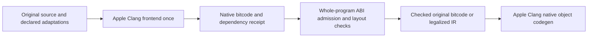

# IR/ABI performance sprint

Scope: the existing source-owned native IR/ABI pipeline only. Gameplay and
renderer work are paused for this sprint. Preserve the supported `build.sh`
entrypoint, Apple Clang, the full production census, source ownership, ABI
rejections and out-of-source generation. No PCH, unity build, external cache,
historical compiled input or reduced production configuration.

## Objective and honest accounting

The target is less than one second for the clean-build IR/ABI section with the
same checks. It is an unachieved target. Measure clean, changed-source and
unchanged-input runs separately. A warm receipt hit is not clean-build evidence.
Report both stage wall time and end-to-end build time; transferring work to
another stage is not an improvement by itself.

The old separate frontend work cannot simply disappear. Sharing its result with
ordinary native object production is the architectural candidate, subject to
preserving compiler flags, diagnostics, depfiles, Apple/LLVM IR compatibility
and code generation semantics. It is not implemented by this sprint's first
changes. A compact summary must carry every fact required by admission; it must
not turn absence of information into permission to transform.

## Existing baseline

The profiled production census contains 1,259 translation units, about 105.8 MB
of textual IR, 34,963 definitions and 1,195,744 prepared instructions.

| Measured operation | Seconds |
| --- | ---: |
| Complete stage | 101.95 wall |
| IR census | 62.54 wall |
| Analyzer process | 37.55 wall |
| Layout validation within analyzer | 30.80 |
| Pointer analysis within analyzer | 4.11 |
| IR parsing across modules | 2.15 |
| Preparation across modules | 0.14 |

Clang's compiler intervals sum to 59.60 seconds across processes; driver member
emission intervals sum to 497.29 seconds across eight workers. These are
different scopes, not additive CPU samples. Header trace intervals nest. The
next trace splits subprocess, dependency resolution and receipt work explicitly.

Depfiles contain 588,482 dependency-path occurrences but only 2,996 distinct
spellings. The repeated filesystem work is a concrete optimization opportunity;
the count is not a measured speedup. The ignored binary directory holds
`semantic-slots/sprint-baseline.json`, including a semantic-plan digest for
comparison on the same inputs.

## First transformations, pending measurement

1. Replace recursive type-containment traversal with iterative reachability over
   structure-element and array-element edges. Pointer pointees remain excluded.
   A visited set bounds each uncached query by reachable vertices and edges,
   rather than copying the visited set and repeatedly exploring shared branches.
   Memoize only completed `(root type, target-name set)` results within a World;
   type bodies are immutable during analysis and validation. Do not memoize
   partial negative results inside a traversal. This preserves cycle behavior.
2. Intern dependency-path resolution within one census. Use the original
   symlink-aware `Path.resolve` operation once per `(working directory, spelling)`.
   Hash validation remains intact; no filesystem identity is imported from a
   previous process. The cache is bounded by this census's unique paths.

The existing admission/rejection suite remains required, including real task
lifetimes, raw-byte observations, layout offsets/strides and guest/native
separation. A new nested shared-subtype negative fixture exercises observation
of an enclosing owner with repeated by-value subtypes. Performance claims require
matching semantic plans and successful focused tests, followed by the maintained
full suite through the supported build entrypoint.

## Subsequent decisions depend on measurements

- If graph construction dominates, summarize immutable callee returns once and
  propagate only newly discovered facts with a worklist.
- If type queries still dominate, intern target sets and represent candidate
  membership as compact bitsets, retaining the same reachability relation.
- If dependency handling dominates, separate tokenizer, canonicalization and
  hash costs before changing the depfile parser. Preserve escaping and spaces.
- If frontend work dominates after driver improvements, design one frontend
  result shared by analysis and native object generation. Validate against the
   original production compiler commands before changing object ownership.

## Measured sprint results

The preservation argument for these changes is small:

- Type containment is existential reachability over the same by-value edges.
  Visiting a shared node once cannot change whether a target is reachable.
  Completed-query memoization is valid while those type bodies are immutable.
- Ownership and extent propagation use set union on finite domains. The least
  fixed point is independent of worklist order, permitting dense pointer maps
  without changing the facts or rejection reasons.
- Address recursion keeps the same depth limit and branch-local ancestor set;
  its contiguous representation changes storage, not cycle detection.
- Independent modules own separate LLVMContexts. Parallel readers publish into
  manifest-ordered slots and join before cross-module analysis begins.
- Text and bitcode are interchange representations. Tests compare the
  transformed IR structurally and execute it, rather than assuming a format
  conversion is correct. Receipt hashes cover the actual consumed bytes.

The user authorized isolated compiler builds, benchmarks and focused correctness
tests, while retaining the prohibition on a full build or game launch.

| Experiment | Wall seconds | Equivalence evidence |
| --- | ---: | --- |
| Existing analyzer binary | 38.59 | Baseline semantic plan |
| Iterative/memoized type queries, same unoptimized tool | 9.19 | Identical plan bytes |
| Optimized tool, text input | 3.37, 3.35 | Identical plan bytes |
| Bitcode and parallel independent module readers | 1.30, 1.30 | Same plan after input-path normalization |
| Contiguous bounded recursion paths and dense pointer-keyed maps | 1.07, 1.08 | Same plan after input-path normalization |
| Final fresh IR census, default configuration and assertions enabled | 14.11 | Same plan; all 1,259 inputs freshly emitted |

The final census measured 12.01 seconds for IR emission/validation, 1.45 seconds
for the analyzer, and about 0.64 seconds for setup, lifetime checks and outputs.
It used an isolated binary directory with redirected object paths and an empty
IR receipt set. Existing configured/generated production source inputs were read;
no production object or library was an input. This is a fresh IR census, **not**
a complete clean configuration/assets/game build. Repeated analyzer timings do
not reuse an analysis plan, but can benefit from OS filesystem caches.

Bitcode reduced the measured input from 105.8 MB to 26.1 MB. Module readers own
separate LLVMContexts, use bounded parallelism and preserve manifest order.
Timing records belong to each owned Unit rather than a shared mutable array.
The dependency tokenizer retains shlex for quoted, escaped and unusual paths;
ordinary ASCII paths use the equivalent native split operation.

The object launcher now code-generates the checked native IR for both changed
and unchanged representations, instead of invoking the C/C++ frontend again.
Frontend optimization and debug modes are preserved; only LLVM passes are
disabled before analysis. Every consumed IR file is hash-checked. Known
production command changes require a renewed census. Full-game end-to-end
savings from this ownership change are not measured, because no full build was
run.

The exploratory optimized-tool measurements above used an isolated Release
configuration. The production default adds only `-O2`, retaining assertions;
the exact default configuration was also rebuilt and measured with assertions
enabled: 1.05 and 1.04 seconds on the last two analyzer runs, with identical plans. No correctness check is disabled by the
default CMake change.

The focused pointer-slot suite passed: original accessor/task lifetime execution
at O0/O2, guest layout preservation, negative admission cases, nested shared
owners, text/bitcode structural equivalence, native record/varargs handoff,
optimization macros, PIC codegen and corrupted-bitcode rejection. Compiler
component regression results are recorded in the isolated binary directory.

The tweet's useful principle is explicit ownership and bounded views, as
described in [Karadžić's article](https://bkaradzic.github.io/posts/memory-management/).
No allocator library or framework was added. Ownership and avoiding repeated
discovery are the relevant ideas; allocator benchmark numbers are not used as
predictions for this pipeline.

The complete section is **not yet below one second**. Its largest remaining
cost is actual source frontend work, about 89 seconds of overlapping compiler
process intervals across eight workers in the measured fresh census. Do not
present sub-second core analysis as sub-second source compilation or hide
frontend work by renaming stages.

The parallel-destruction experiment was rejected: it increased repeated analyzer
wall time to about 1.25 seconds from about 1.05 seconds. Serial destruction was
restored; only independent module loading remains parallel. This is evidence for
keeping the ownership model simple, not for adding an allocator abstraction.

### Native object ownership: removing repeated global JSON parsing

The native compiler launcher previously parsed the entire 67,154,769-byte
registry for each production translation unit to select one record. Across
1,259 units this describes about 79 GiB of repeated logical JSON input, even
when all frontend IR was already current. Each object also depended on the
global registry and plan, making unrelated metadata changes invalidate objects.

The mandatory census now publishes a small `members/<identity>/codegen.json`
for each exact target/source pair. It includes the command identity, effective
IR content hash, and codegen compiler identities. Apple Clang consumes the same
IR with the same flags. Object dependencies belong to that approval, effective
IR, and compiler inputs. The global analysis still runs before native codegen;
source/header/compiler changes still refresh its receipts. Byte-identical IR
and approvals retain their timestamps. Missing approvals are restored only from
the current successful census. Existing objects with old global depfiles are
invalidated once to install the precise dependencies.

A focused comparison generated fresh native objects for 16 production units,
using existing checked IR, identical compiler flags, and the pinned Python:
2.1539 seconds before, 0.2717 seconds after (7.9x). Every object was byte-identical.
These are **16-unit component timings**, not fresh-clone or full-native-build
timings. The approximately 63.3 seconds outside the previously measured provider
invocation is a residual, not an independently timed phase, and has not been
shown to fall below one second.

`native_codegen_dependencies` configures a fresh, isolated Unix Makefiles
project with real Clang bitcode and the production analyzer/launcher. It verifies
mandatory census execution, stable objects on global-only changes, one-unit
invalidation, missing approval restoration, command mismatch rejection and IR
corruption rejection. Its fixture uses paths containing spaces. No full game
build or runtime launch was used for this component validation.
